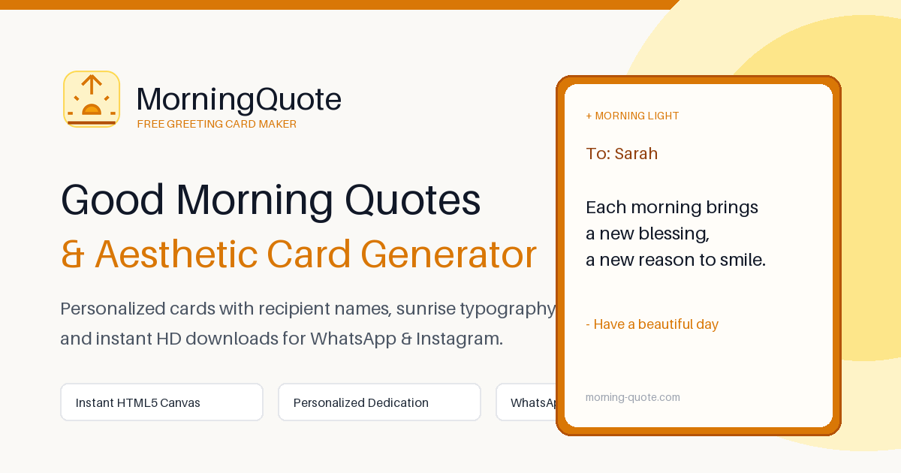

# Morning Quote - Client-Side Greeting Card Generator

[](https://morning-quote.com/)
[](LICENSE)
[](https://vitejs.dev/)
[](https://www.typescriptlang.org/)

> **Live Production Tool**: [https://morning-quote.com/](https://morning-quote.com/)  
> Create aesthetic, high-resolution morning quotes and greeting cards directly in your browser. Zero tracking, zero ads, 100% client-side Canvas rendering.

---

## Overview

**Morning Quote** is a blazing-fast, client-side web application designed to turn inspirational words and quotes into stunning visual greeting cards for WhatsApp, Instagram Stories, Facebook, and daily motivation.

This repository open-sources the **Core Canvas Card Rendering Engine** and responsive card generator UI powering [Morning Quote](https://morning-quote.com/).



---

## Key Features

- **Instant 2D Canvas Engine**: Pure client-side rasterization with sub-millisecond redraws. No backend rendering bottlenecks or image proxy latencies.
- **Dynamic Presets & Typography**: Handcrafted sunrise backdrops, coffee themes, nature vistas, and responsive font-scaling algorithms.
- **Dual Aspect-Ratio Switching**:
  - **1:1 Square (1080x1080)**: Optimized for Instagram Posts, WhatsApp DP, and social feeds.
  - **9:16 Vertical Story (1080x1920)**: Tailored for TikTok, Instagram Stories, and mobile wallpapers.
- **Internationalization (i18n Ready)**: Multi-language quote datasets supporting English, Spanish (Español), and Portuguese (Português).
- **Privacy by Design**: All image generation and downloads happen entirely in the user's browser via Canvas APIs.

---

## Architecture & Core Engine

The core rendering engine lives under `src/engine/`:

- **`CardRenderer.ts`**: The primary Canvas compositor. Handles retina screen pixel-ratio scaling, gradient overlays, text wrap calculations, drop shadows, and multi-line typographic balance.
- **`presets.ts`**: Curated styling presets (fonts, background textures, color schemes, accent badges).
- **`quotes.ts`**: Extensible quote database indexed by mood, theme, and language.

---

## Quick Start

```bash
# 1. Clone the repository
git clone https://github.com/tangtang-it/morning-quote.git
cd morning-quote

# 2. Install dependencies
pnpm install

# 3. Start development server
pnpm dev
```

Open http://localhost:5173 in your browser.

### Build for Production

```bash
pnpm build
```

---

## Official Website & Live Experience

Experience the full-featured production version with curated daily collections, trending cards, and instant sharing:

👉 **[https://morning-quote.com/](https://morning-quote.com/)**

- **English Version**: [morning-quote.com](https://morning-quote.com/)
- **Spanish Version (Español)**: [morning-quote.com/es/](https://morning-quote.com/es/)
- **Portuguese Version (Português)**: [morning-quote.com/pt/](https://morning-quote.com/pt/)

---

## License

This core repository is open-sourced under the [MIT License](LICENSE).